# Biblioteca Municipal de Palín

Proyecto final individual de Programación Web, segundo semestre de 2026.
Sistema web para administrar el catálogo, los lectores, los préstamos y las devoluciones de la biblioteca.

## Estado del proyecto

Etapa de propuesta (18 de octubre de 2026). Este repositorio contiene la documentación inicial; la aplicación todavía no está implementada.

## Alcance previsto

- Administrar libros, lectores y usuarios.
- Registrar, consultar, editar y eliminar préstamos según permisos y validaciones.
- Registrar devoluciones y calcular multas por atraso.
- Consultar la disponibilidad de ejemplares.
- Buscar libros por título, autor o ISBN desde tres caracteres, mediante fetch() y JSON.
- Consultar préstamos vencidos a una fecha y los diez libros más prestados de un mes.
- Proteger las páginas internas mediante sesión y permisos por rol.

No se incluyen pagos en línea, reservas, notificaciones por correo ni acceso público de lectores.

## Roles

| Rol | Permisos previstos |
| --- | --- |
| Bibliotecario (administrador) | Gestionar catálogo, lectores, préstamos, devoluciones y usuarios; consultar reportes. |
| Auxiliar | Consultar catálogo y lectores; registrar préstamos y devoluciones. No modifica catálogo, lectores ni usuarios y no elimina préstamos. |

Los permisos se comprobarán en el servidor, también al acceder directamente a una URL.

## Stack seleccionado

- PHP 8.x con arquitectura MVC propia.
- Apache y MariaDB mediante XAMPP.
- PDO para acceso a datos con consultas preparadas.
- HTML5, CSS3 y JavaScript con fetch().
- Git y GitHub; editor Visual Studio Code.
- Recursos CSS/JS locales para funcionar sin conexión a internet.

## Modelo de datos propuesto

La tabla principal es `prestamos`. Cada préstamo representa un ejemplar de un libro.
Se añade `usuario_id` a la ficha base para identificar al usuario que registra el préstamo.

```mermaid
erDiagram
    libros ||--o{ prestamos : registra
    lectores ||--o{ prestamos : solicita
    usuarios ||--o{ prestamos : registra
    libros {
        int id PK
        varchar isbn UK
        varchar titulo
        varchar autor
        varchar categoria
        smallint anio
        int ejemplares_totales
    }
    lectores {
        int id PK
        varchar carne UK
        varchar nombre
        varchar telefono
        enum tipo
        enum estado
    }
    usuarios {
        int id PK
        varchar usuario UK
        varchar password_hash
        varchar nombre
        enum rol
        boolean activo
    }
    prestamos {
        int id PK
        int libro_id FK
        int lector_id FK
        int usuario_id FK
        date fecha_prestamo
        date fecha_limite
        date fecha_devolucion
        decimal multa
    }
```

Cada préstamo pertenece a exactamente un libro, un lector y un usuario. Cada libro, lector o usuario puede tener cero o muchos préstamos asociados.

## Reglas de negocio

1. Disponibles = ejemplares totales menos préstamos sin devolver de ese libro; no se presta sin disponibilidad.
2. Un lector puede tener como máximo tres préstamos activos.
3. El plazo es de siete días. Al devolver, la multa es Q 2.00 por día de atraso, con mínimo Q 0.00.
4. Un lector con préstamos vencidos no puede recibir nuevos préstamos.
5. Las reglas se validan en el servidor. Se impedirán eliminaciones que rompan relaciones existentes; los usuarios pueden desactivarse.

## Seguridad prevista

Contraseñas con password_hash/password_verify; consultas preparadas PDO; escape con htmlspecialchars; tokens CSRF; validación de entradas; errores comprensibles sin detalles técnicos.

## Entregas

| Fecha | Entrega |
| --- | --- |
| 18/10/2026 | Propuesta y repositorio con README inicial |
| 25/10/2026 | MVC, base de datos y CRUD de prestamos; etiqueta checkpoint-1 |
| 08/11/2026 | Autenticación, roles y AJAX; etiqueta checkpoint-2 |
| 22/11/2026 | Sistema completo y defensa; etiqueta final |

El historial reflejará el avance real con al menos quince commits distribuidos durante el período.

## Instalación y pruebas

En esta etapa solo hay documentación. Para la aplicación se requerirán XAMPP con PHP 8.x, MariaDB y PDO habilitado. Los pasos de instalación, database.sql con datos de prueba, un usuario de prueba por rol y las capturas se incorporarán a medida que se implemente y compruebe el sistema.

## Uso de inteligencia artificial

Se utilizó ChatGPT/Codex como apoyo para organizar la propuesta, elaborar un modelo de datos preliminar y redactar la documentación inicial. El estudiante debe revisar y comprender el contenido y el código que se incorpore. Esta sección se actualizará conforme al uso real de la herramienta.
