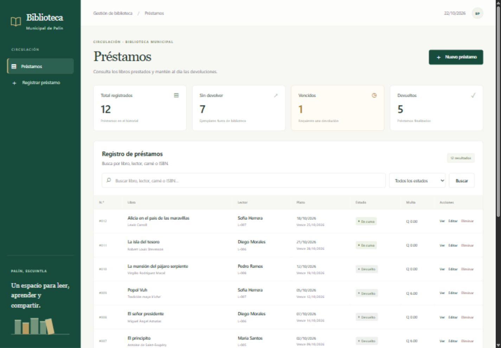
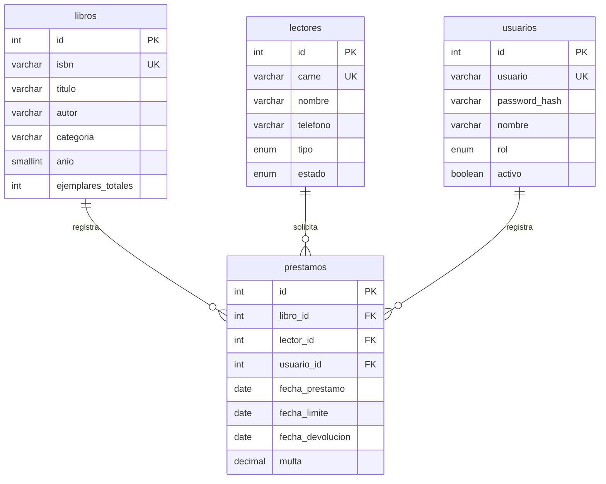

# Biblioteca Municipal de Palín

Proyecto final individual de Programación Web, segundo semestre de 2026.
Sistema web para administrar el catálogo, los lectores, los préstamos y las devoluciones de la biblioteca.

## Estado del proyecto

Checkpoint 1 implementado: arquitectura MVC, base de datos MariaDB y CRUD completo de `prestamos`, con búsqueda, filtros, confirmación antes de eliminar y validación del servidor. La instalación inicial incluye 12 préstamos, 10 libros, 10 lectores y 2 usuarios de prueba.

La etiqueta de esta entrega es [`checkpoint-1`](https://github.com/danielbenito4-svg/biblioteca-municipal-palin/tree/checkpoint-1). La demostración de tres minutos está en [docs/checkpoint-1.md](docs/checkpoint-1.md).



El inicio de sesión, los permisos por rol y el endpoint AJAX corresponden al checkpoint 2. En esta versión local, las operaciones se atribuyen al usuario de demostración con id 1; todavía no hay autenticación ni autorización por roles.

## Alcance previsto

- Administrar libros, lectores y usuarios.
- Registrar, consultar, editar y eliminar préstamos según permisos y validaciones.
- Registrar devoluciones y calcular multas por atraso.
- Consultar la disponibilidad de ejemplares.
- Buscar libros por título, autor o ISBN desde tres caracteres, mediante fetch() y JSON.
- Consultar préstamos vencidos a una fecha y los diez libros más prestados de un mes.
- Proteger las páginas internas mediante sesión y permisos por rol.

No se incluyen pagos en línea, reservas, notificaciones por correo ni acceso público de lectores.

## Roles

| Rol | Permisos previstos |
| --- | --- |
| Bibliotecario (administrador) | Gestionar catálogo, lectores, préstamos, devoluciones y usuarios; consultar reportes. |
| Auxiliar | Consultar catálogo y lectores; registrar préstamos y devoluciones. No modifica catálogo, lectores ni usuarios y no elimina préstamos. |

Los permisos se comprobarán en el servidor, también al acceder directamente a una URL.

## Stack seleccionado

- PHP 8.x con arquitectura MVC propia.
- Apache y MariaDB mediante XAMPP.
- PDO para acceso a datos con consultas preparadas.
- HTML5, CSS3 y JavaScript con fetch().
- Git y GitHub; editor Visual Studio Code.
- Recursos CSS/JS locales para funcionar sin conexión a internet.

## Modelo de datos propuesto

La tabla principal es `prestamos`. Cada préstamo representa un ejemplar de un libro.
Se añade `usuario_id` a la ficha base para identificar al usuario que registra el préstamo.



Cada préstamo pertenece a exactamente un libro, un lector y un usuario. Cada libro, lector o usuario puede tener cero o muchos préstamos asociados.

## Reglas de negocio

1. Disponibles = ejemplares totales menos préstamos sin devolver de ese libro; no se presta sin disponibilidad.
2. Un lector puede tener como máximo tres préstamos activos.
3. El plazo es de siete días. Al devolver, la multa es Q 2.00 por día de atraso, con mínimo Q 0.00.
4. Un lector con préstamos vencidos no puede recibir nuevos préstamos.
5. Las reglas se validan en el servidor. Se impedirán eliminaciones que rompan relaciones existentes; los usuarios pueden desactivarse.

## Seguridad del checkpoint 1

Consultas preparadas PDO, escape con `htmlspecialchars`, tokens CSRF en operaciones de escritura, validación en cliente y servidor, rutas permitidas por lista y métodos HTTP comprobados. Los errores técnicos se registran en `storage/php-error.log`, fuera de las vistas y protegido por Apache.

Las contraseñas de los usuarios de prueba ya se almacenan con hash. El inicio de sesión con `password_verify` y la comprobación de roles se implementarán en el checkpoint 2. La versión actual está pensada para la demostración local del primer avance.

## Entregas

| Fecha | Entrega |
| --- | --- |
| 18/10/2026 | Propuesta y repositorio con README inicial |
| 25/10/2026 | MVC, base de datos y CRUD de prestamos; etiqueta checkpoint-1 |
| 08/11/2026 | Autenticación, roles y AJAX; etiqueta checkpoint-2 |
| 22/11/2026 | Sistema completo y defensa; etiqueta final |

El historial reflejará el avance real con al menos quince commits distribuidos durante el período.

## Instalación y pruebas

Requisitos: XAMPP con Apache, PHP 8.2 o superior, MariaDB 10.4 o superior y extensiones `pdo_mysql`, `mbstring` y `curl` (esta última para las pruebas HTTP). No requiere Composer, Node, frameworks, librerías de terceros ni conexión a internet durante la demostración.

1. Iniciar **Apache** y **MySQL** desde XAMPP.
2. Clonar o descargar este repositorio dentro de `C:\xampp\htdocs\biblioteca-palin`.
3. Abrir `http://localhost/phpmyadmin`, elegir **Importar** y seleccionar `database.sql`. El script crea la base `biblioteca_palin`, sus cuatro tablas, restricciones y datos de prueba. Importarlo una sola vez en una instalación nueva; no elimina bases ni tablas existentes.
4. La configuración local predeterminada es `127.0.0.1:3306`, usuario `root` y contraseña vacía, habitual en XAMPP de desarrollo. Si el entorno usa otros valores, copiar `config/database.local.example.php` como `config/database.local.php` y ajustar los datos. Este archivo local está excluido de Git. También se aceptan las variables `DB_HOST`, `DB_PORT`, `DB_DATABASE`, `DB_USERNAME` y `DB_PASSWORD`.
5. Abrir **http://localhost/biblioteca-palin/**.

La zona horaria del sistema es `America/Guatemala`. Las fechas de los datos de prueba se calculan al importar, para disponer de casos en curso, vencidos y devueltos. Los nombres, teléfonos e identificadores del catálogo son datos de demostración.

### Organización MVC

```text
index.php                   Enrutador de entrada y controles HTTP/CSRF
config/
  bootstrap.php             Inicio, autoload y funciones compartidas
  database.php              Configuración de conexión
  Conexion.php              Conexión PDO
controllers/
  PrestamoController.php    Recibe solicitudes y elige modelos y vistas
models/
  Prestamo.php              Consultas, transacciones y reglas de negocio
  Catalogo.php              Libros, lectores y operador de registro
  ValidationException.php   Errores de validación del formulario
views/
  layout/                   Estructura compartida de las páginas
  prestamos/                Listado, formulario, detalle y confirmación
public/css/ y public/js/    Recursos locales de la interfaz
database.sql                Esquema y datos de prueba
tests/                      Pruebas de integración y HTTP
docs/                       Guía de exposición y capturas
```

Las vistas no ejecutan SQL y el controlador no construye HTML. `usuario_id` conserva al operador original al editar. La fecha límite y la multa siempre se calculan en PHP; los valores enviados por el navegador no pueden reemplazarlos. La disponibilidad se calcula desde los préstamos sin devolución, en lugar de almacenar otro contador que pueda desajustarse.

### Probar el sistema

Con MariaDB iniciado, ejecutar en una terminal:

```powershell
C:\xampp\php\php.exe tests\integration.php
```

La prueba crea una base temporal con nombre aleatorio, verifica el CRUD, las cuatro reglas, fechas, multas, integridad referencial y búsquedas, y elimina únicamente esa base temporal al terminar. Requiere permisos para crear bases locales.

Con Apache y la aplicación instalados:

```powershell
C:\xampp\php\php.exe tests\http.php
```

La prueba HTTP verifica formularios, persistencia, errores, CSRF, métodos HTTP y escape XSS. Crea su propio préstamo de prueba y lo elimina al terminar. Se puede pasar una URL local diferente como primer argumento.

Validación realizada: **32 comprobaciones de integración y 21 HTTP correctas**, además del recorrido del CRUD en navegador y revisión de la interfaz en escritorio y celular.

### Usuarios de demostración

| Usuario | Contraseña de prueba | Rol previsto |
| --- | --- | --- |
| `bibliotecario` | `Biblioteca2026!` | Bibliotecario |
| `auxiliar` | `Auxiliar2026!` | Auxiliar |

Estos usuarios están preparados en la base para el checkpoint 2; en el checkpoint 1 todavía no se solicita iniciar sesión.

## Uso de inteligencia artificial

Se utilizó ChatGPT/Codex como apoyo para organizar la propuesta, elaborar el modelo de datos, implementar el checkpoint 1, depurar el código, preparar pruebas y redactar la documentación. El estudiante debe revisar y comprender el código, practicar la demostración y poder explicar o modificar lo que entregue. Esta sección se actualizará conforme al uso real de la herramienta.
