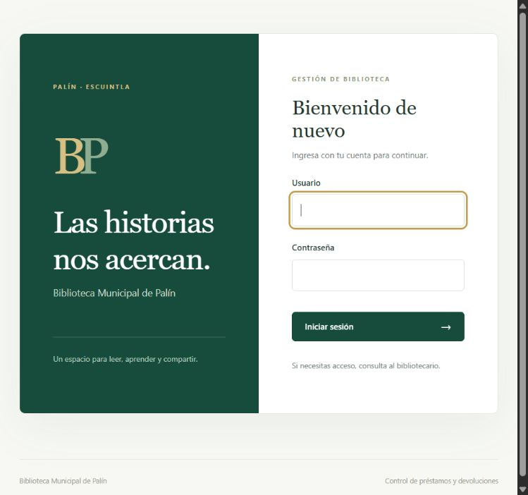
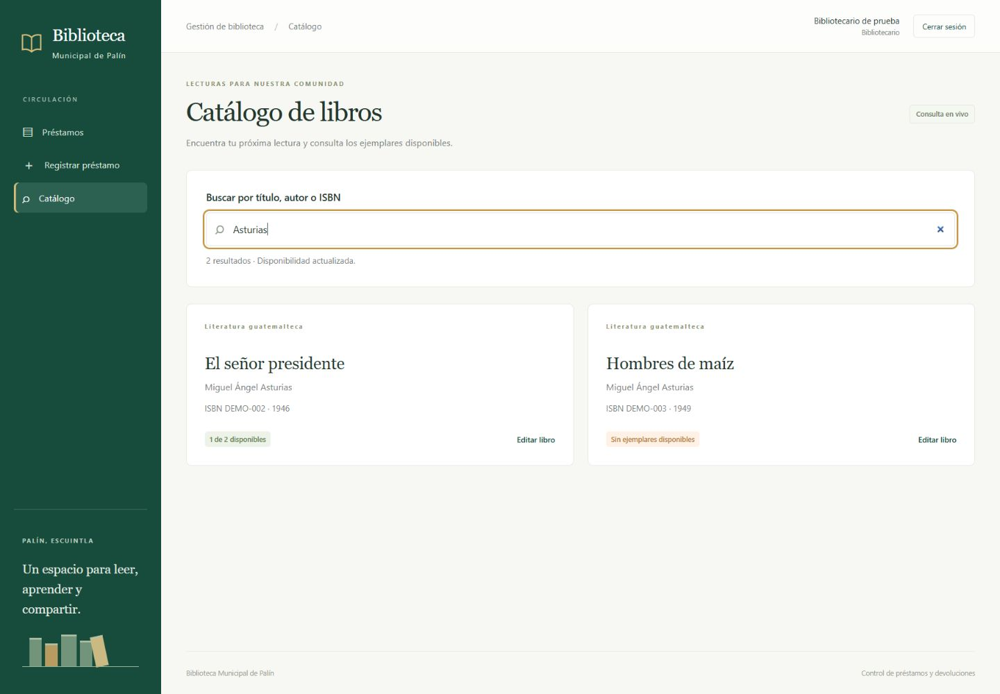

# Checkpoint 2 — Autenticación, roles, AJAX y seguridad

Ficha 4: Biblioteca Municipal de Palín. Entrega del 08/11/2026. Implementación y validación: 04/11/2026.

Repositorio: https://github.com/danielbenito4-svg/biblioteca-municipal-palin

Etiqueta: https://github.com/danielbenito4-svg/biblioteca-municipal-palin/tree/checkpoint-2

## Preparación

1. Iniciar Apache y MySQL de XAMPP.
2. Abrir `http://localhost/biblioteca-palin/` y dejar la sesión cerrada.
3. Tener abiertas estas partes del código: `index.php`, `models/Usuario.php`, `config/Autenticacion.php`, `controllers/CatalogoController.php`, `models/Catalogo.php` y `public/js/app.js`.
4. Usar los datos existentes del checkpoint 1: no hace falta reimportar la BD. Los préstamos viejos pueden aparecer vencidos según la fecha actual; es el comportamiento esperado.
5. Tener listo [el checklist completado](seguridad-checkpoint-2.md). No hace falta conexión a internet para ejecutar la aplicación.

| Usuario | Contraseña | Rol |
| --- | --- | --- |
| bibliotecario | Biblioteca2026! | Administrador |
| auxiliar | Auxiliar2026! | Auxiliar |

## Demostración de tres minutos

| Tiempo | Acción y explicación |
| --- | --- |
| 0:00–0:25 | Abrir `index.php?c=prestamos&a=index` sin sesión: redirige al login. Entrar como **bibliotecario**. Explicar que la contraseña se compara con un hash, se regenera la sesión y se protegen las páginas internas. |
| 0:25–1:10 | Abrir **Catálogo**. Escribir `Po`: aún no busca. Completar `Popol`: aparece el libro con su disponibilidad sin recargar. Buscar `Asturias`: se ven dos libros y uno sin ejemplares disponibles. Buscar `DEMO-010` para mostrar búsqueda por ISBN. Explicar que `fetch()` consume el endpoint JSON propio y que disponibilidad = total − préstamos sin devolver. |
| 1:10–1:35 | Volver a `Asturias` y abrir **Editar El señor presidente**. Mostrar que el administrador tiene acceso al formulario. Volver sin guardar y cerrar sesión. |
| 1:35–2:15 | Entrar como **auxiliar**. Mostrar que puede abrir **Registrar préstamo**, editar un préstamo para una devolución y consultar el catálogo. No aparecen botones de eliminar. Abrir directamente `index.php?c=catalogo&a=editar&id=1`: **Acceso restringido**, HTTP 403. También se bloquea `index.php?c=prestamos&a=confirmarEliminar&id=1`. |
| 2:15–2:45 | Mostrar el checklist y señalar en código: matriz de rutas en `index.php`, `password_verify` en `Usuario.php`, consultas preparadas en `Catalogo.php`, `textContent` en JS y token CSRF de los formularios. Indicar que los permisos se comprueban antes de ejecutar el controlador. |
| 2:45–3:00 | Cerrar sesión e intentar una página interna: vuelve al login. Mostrar la etiqueta `checkpoint-2` en GitHub y mencionar **47 pruebas de integración + 67 HTTP correctas**. |

## Relación con la rúbrica

| Criterio | Implementación y evidencia |
| --- | --- |
| Login/logout y páginas protegidas (2 pts) | `Usuario`, `AuthController`, `Autenticacion` y guardia en `index.php`; hash, sesión regenerada, caducidad y logout real. |
| Roles comprobados en servidor (1 pt) | Matriz de rutas para bibliotecario/auxiliar; rechazo 403 de URL y POST manual, rol vigente leído de BD. |
| AJAX de la ficha (2 pts) | Catálogo desde 3 caracteres, título/autor/ISBN, disponibilidad real; `fetch()` → `catalogo/buscar` → JSON, sin recarga. |
| Checklist de seguridad aplicado (1 pt) | [Checklist completo](seguridad-checkpoint-2.md), PDO, escape XSS, CSRF y pruebas reproducibles. |

## Cómo funciona la búsqueda

La vista de catálogo contiene el campo y el destino de resultados. JS espera 300 ms desde la última escritura, cancela la solicitud anterior y solo acepta la respuesta de la búsqueda más reciente. PHP exige sesión y valida la consulta; el modelo busca mediante parámetros y calcula disponibilidad con una subconsulta. El controlador responde JSON. JS construye las tarjetas con `textContent` y muestra estados de carga, sin resultados, error de conexión y sesión vencida.

Ejemplo autenticado:

```text
GET index.php?c=catalogo&a=buscar&q=Asturias
Content-Type: application/json; charset=UTF-8
```

El endpoint solo admite GET. Sin sesión responde 401 JSON; si la consulta tiene menos de 3 o más de 100 caracteres, responde 422. No devuelve contraseñas, hashes ni información de usuarios.

## Validación realizada

- PHP sin errores de sintaxis y `git diff --check` sin errores.
- **47 comprobaciones de integración** en BD temporal: CRUD, reglas RN-01 a RN-04, integridad, hash, roles vigentes, cuentas inactivas, caducidad y actualización de catálogo.
- **67 comprobaciones HTTP** contra Apache: login/logout, cookies, rotación de sesión/CSRF, páginas protegidas, permisos, parámetros manipulados, JSON, SQL/XSS y CRUD.
- Navegador: ambos roles, AJAX real por autor y título, mínimo de caracteres, libro sin disponibilidad, bloqueo por URL, escritorio y móvil de 390 px sin desplazamiento horizontal de la página.
- No se borraron ni reinicializaron los datos originales: permanecen los 12 préstamos de la demostración.





## Para Classroom

Adjuntar como enlace la etiqueta `checkpoint-2`. Esta etiqueta identifica un commit concreto del repositorio. La demostración de clase sigue siendo parte de la entrega.

Texto sugerido: «Checkpoint 2 — Biblioteca Municipal de Palín. Inicio/cierre de sesión, control de roles en el servidor, búsqueda AJAX del catálogo con disponibilidad y checklist de seguridad aplicado. Código y evidencias en la etiqueta checkpoint-2.»
