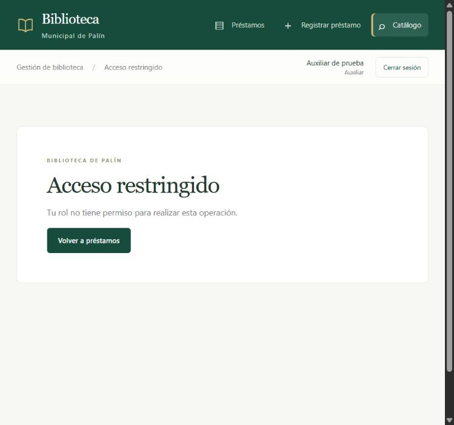

# Checklist de seguridad — Checkpoint 2

Proyecto 4: Biblioteca Municipal de Palín. Validado el 04/11/2026 en PHP 8.2, Apache y MariaDB de XAMPP.

## Controles aplicados

- [x] **Hash de contraseñas.** `usuarios.password_hash` almacena bcrypt, nunca la contraseña en texto. `models/Usuario.php` usa `password_verify` y actualiza hashes con `password_hash(PASSWORD_DEFAULT)` cuando hace falta. No devuelve el hash al controlador ni al JSON.
- [x] **Inicio y cierre de sesión.** Login por POST con CSRF, identificador regenerado al autenticar, token previo descartado. Logout por POST destruye la sesión y elimina la cookie. No se acepta salir mediante GET.
- [x] **Páginas internas protegidas.** Cada ruta interna declara roles permitidos en `index.php`. Sin sesión, las páginas redirigen al login; el endpoint devuelve JSON con HTTP 401. No se ejecuta el controlador protegido.
- [x] **Autorización en el servidor.** El auxiliar recibe HTTP 403 en edición de catálogo y eliminación de préstamos, incluso mediante URL directa y POST con token válido. Enviar `rol=bibliotecario` no otorga permisos.
- [x] **Usuario activo y rol vigente.** Se consultan en BD en cada petición. Desactivar una cuenta invalida su sesión y cambiar su rol modifica inmediatamente sus permisos.
- [x] **Sesión limitada.** Caduca tras 30 minutos sin actividad. Se usan cookies HttpOnly, SameSite=Lax, solo cookies y modo estricto; Secure se activa cuando hay HTTPS. La demostración local utiliza HTTP.
- [x] **Consultas preparadas.** Login, búsquedas, consultas por ID y escrituras utilizan parámetros PDO con emulación desactivada. Las consultas sin parámetros de usuario son SQL constante. Los filtros y rutas se seleccionan de listas permitidas; los comodines de búsqueda se tratan literalmente.
- [x] **Protección XSS.** Las vistas escapan texto y atributos mediante `e()` (`htmlspecialchars`, ENT_QUOTES). AJAX crea nodos con `textContent` y no utiliza `innerHTML`. JSON tiene Content-Type correcto y codificación HEX de caracteres HTML.
- [x] **Protección CSRF.** Todos los POST, incluidos login y logout, requieren un token aleatorio de sesión y comparación con `hash_equals`. Un token ausente, incorrecto o anterior al login produce HTTP 403.
- [x] **Validación en servidor.** IDs, longitudes, números y fechas se validan aunque se eludan los controles HTML. La búsqueda acepta entre 3 y 100 caracteres y devuelve como máximo 30 libros. El catálogo no permite ISBN duplicado ni reducir existencias por debajo de los ejemplares sin devolver.
- [x] **Integridad de préstamos.** Se conservan las cuatro reglas de negocio, las transacciones y los bloqueos de lector/libro. La multa y la fecha límite se calculan en PHP; el operador de un alta procede de la sesión, aunque el POST intente cambiarlo.
- [x] **Métodos y errores.** Lista cerrada de rutas, HTTP 404/405/403/422 según el caso, errores técnicos solo en log protegido. Las respuestas JSON de error no contienen HTML ni detalles de conexión.
- [x] **Cabeceras y archivos privados.** Respuestas privadas con `Cache-Control: no-store`, CSP con recursos locales, `nosniff` y política de referente. Apache bloquea config, modelos, controladores, vistas, pruebas, documentación interna, logs y SQL; no muestra directorios. La configuración local está excluida de Git.

## Matriz de permisos implementada

| Acción | Bibliotecario | Auxiliar | Sin sesión |
| --- | --- | --- | --- |
| Consultar préstamos y detalles | Sí | Sí | Login |
| Crear/editar préstamos y registrar devoluciones | Sí | Sí | Login |
| Confirmar/eliminar un préstamo | Sí | HTTP 403 | Login |
| Consultar catálogo | Sí | Sí | Login |
| Buscar catálogo mediante JSON | Sí | Sí | HTTP 401 JSON |
| Editar/guardar datos de un libro | Sí | HTTP 403 | Login |
| Cerrar sesión | POST + CSRF | POST + CSRF | Login |

Las altas/bajas del catálogo, la administración de lectores/usuarios y los reportes se completarán para la entrega final. Una función todavía no implementada no tiene una ruta habilitada.

## Evidencias reproducibles

```powershell
C:\xampp\php\php.exe tests\integration.php
C:\xampp\php\php.exe tests\http.php
```

Resultado: **47 comprobaciones de integración y 67 HTTP correctas**. Las pruebas de integración usan una base temporal y verifican cambios de rol, cuenta inactiva y caducidad sin modificar usuarios reales. Las pruebas HTTP ejercitan ambos roles, intentos de escalada por POST, SQL/XSS, CSRF, rotación de sesión, logout, CRUD y JSON. Usan y limpian sus propios préstamos de demostración.

Revisión en navegador: login de ambos roles, búsqueda real con `fetch`, mínimo de tres caracteres, disponibilidad con y sin ejemplares, bloqueo de catálogo por URL y diseño móvil sin desbordamiento horizontal.


